# Phase 8: Dashboards & Frontend Specification

## 1. Ground Rules

All Phase 8 implementation tasks must adhere strictly to these engineering constraints:

1. **Chunk Scope:** Do ONLY the assigned chunk. Do not introduce unrequested code, models, migrations, endpoints, or UI features.
2. **Database Isolation:** NEVER connect to or execute anything against the shared Supabase database. If any operation would require remote execution, output the exact shell/SQL command with placeholders (e.g. `DATABASE_URL=<SUPABASE_DATABASE_URL>`) for manual project owner execution.
3. **Regression Safety:** Keep all existing tests passing (157+ tests). Run test suites strictly against the local test database (`localhost:5433`).
4. **No Unprompted Commits:** Do NOT make Git commits or create Git tags unless explicitly instructed.
5. **No Strategy Experimentation Machinery:** Comparative evaluation of recommendation strategies or quiz formats is strictly deferred to future scope (post-Phase 8). Do not add experimentation tables, columns, endpoints, or UI toggles; do not mention comparative testing anywhere except in Section 12 ("Future Scope").
6. **Execution Reporting:** Conclude each chunk with a concise operational report detailing files changed, tests run (with real terminal output), any deviations from specification (with verification method), and required manual actions.
7. **Semantic Consistency:** Reuse competency status thresholds and mastery semantics from `docs/KNOWLEDGE_MODEL.md` (via `backend/app/services/bkt.py:classify`) and target difficulty cutoffs from `docs/RECOMMENDER.md` Section 6.1 by reference. Never redefine or duplicate thresholds.
8. **Completion Status Filtering:** Every analytical query across learner and instructor dashboards must explicitly filter `QuizAttempt.status == 'completed'`. In-progress adaptive quiz attempts must never pollute metrics or history.

---

## 2. Scope

### In Scope
- **Learner Dashboard (`/dashboard`):**
  - Personal learning progress overview (topic coverage, attempted topic mastery, status counts, completed quiz count).
  - Per-course radar charts displaying topic mastery distribution.
  - Highlighted strengths (top 3 strong topics) and weaknesses (top 3 weak topics).
  - Current learning path recommendations derived from the learner's most recent recommendation impressions.
  - Interactive recommendation panel with resource opening and click engagement auditing.
  - Paginated completed quiz history table (supporting both fixed course quizzes and single-topic adaptive quizzes).
  - Chronological trend visualizations: quiz score percentage history and cumulative mastery progression.
- **Instructor Dashboard (`/instructor`):**
  - Cohort-level overview metrics (total learners, active learners, completed quizzes, cohort average quiz score, cohort average topic mastery).
  - Per-course breakdown of learner activity and average quiz performance.
  - Learner cohort table listing each learner's attempted topics, average mastery, completed quizzes, average quiz score, and last active timestamp.
  - Topic competency analytics: topic learner reach, average mastery, question accuracy percentage, weak learner share, and status distribution counts.
  - Difficult topics ranking identifying topics with high struggle rates among active learners.
- **Backend Analytics Endpoints:**
  - 6 read-only REST API endpoints under `/api/dashboard/` providing structured Pydantic v2 data payloads.
  - Single-query joins and database aggregations designed to prevent N+1 query overhead.
- **Minimalist React Frontend:**
  - React + TypeScript + Vite single-page application.
  - Clean client-side routing via `react-router-dom`.
  - Responsive charts powered by `Recharts` and modular plain CSS styling.
  - Authentication flow supporting role-based view routing.
  - Dedicated interactive quiz runner interfaces for both single-topic adaptive quizzes and fixed course quizzes.

### Out of Scope
- **No Schema Changes or Migrations:** Zero new tables, columns, or Alembic migrations. All analytics are computed dynamically from existing tables (`quiz_attempts`, `quiz_responses`, `topic_mastery`, `topic_mastery_history`, `recommendation_impressions`, `users`, `courses`, `topics`).
- **No Algorithm Modifications:** No changes to BKT parameter update logic, Dirichlet sampling, or candidate resource recommendation scoring.
- **No Per-Learner Instructor Drill-Down:** The instructor interface is scoped to a unified cohort view; individual learner deep-dive pages are deferred.
- **No Public Registration Page:** Authentication UI is restricted to `/login`. Pre-seeded synthetic learners and instructor accounts are provided for demonstration; new accounts can be registered via Swagger UI (`/docs`) or curl.
- **Deferred Strategy Experimentation:** Project synopsis Module 4 originally mentioned strategy experimentation; this is formally deferred to post-Phase 8 by project decision.

---

## 3. Verified Existing Facts

The following facts were verified through direct read-only inspection of the active codebase:

### a. User Role Storage & Exposure
- **Model Storage:** Stored as `role = Column(String(20), nullable=False, default="learner")` on `User` in `backend/app/models/user.py`.
- **Exact Role Literals:** `UserRegister` in `backend/app/schemas/user.py` restricts roles to `Literal["learner", "instructor"] = "learner"`.
- **Login Exposure:** `POST /api/auth/login` returns `{"access_token": access_token, "token_type": "bearer"}` only; the role is NOT present in the login token response.
- **Me Endpoint Exposure:** `GET /api/auth/me` (`backend/app/routes/auth.py`) returns `UserResponse`, which exposes `id`, `name`, `email`, `role`, and `created_at`.
- **Role Guard Dependency:** `require_role(required_role: str)` already exists in `backend/app/utils/dependencies.py`.

### b. Competency Status Derivation
- **Canonical Helper:** `classify(p: float, total_answers: int) -> str` located in module path `backend/app/services/bkt.py` (`from app.services.bkt import classify`).
- **Thresholds (`bkt_config`):**
  - `not_attempted`: `total_answers <= 0` (including unrecorded topics).
  - `weak`: `total_answers > 0` and `p < 0.40`.
  - `strong`: `p >= 0.80` and `total_answers >= 3`.
  - `developing`: All intermediate cases (`0.40 <= p < 0.80` or `p >= 0.80` with `total_answers < 3`).
- **Reuse Rule:** This function must be imported and called directly; thresholds must never be hardcoded elsewhere.

### c. CORS Configuration
- **FastAPI Configuration:** Configured in `backend/app/main.py` using `CORSMiddleware`.
- **Allowed Origins:** `cors_origins_env = os.getenv("CORS_ORIGINS", "http://localhost:5173,http://127.0.0.1:5173")`.
- **Status:** `http://localhost:5173` is explicitly permitted by default with `allow_credentials=True`, `allow_methods=["*"]`, and `allow_headers=["*"]`.

### d. Existing API Request & Response Shapes
1. **`POST /api/quiz/generate/course/{id}`:**
   - Path parameter: `course_id: int`. No request body.
   - Response: `QuizResponse(course_id: int, questions: list[QuizQuestionResponse])` where each question contains `question_id`, `topic_id`, `question_text`, `option_a..d` (20 questions; correct answers omitted).
2. **`POST /api/quiz/submit`:**
   - Request body: `QuizSubmission(course_id: int, answers: list[QuizAnswer(question_id: int, selected_answer: str)])`.
   - Response: `QuizResult(attempt_id: int, course_id: int, score: int, total_questions: int, percentage: float, correct_answers: int, incorrect_answers: int)`.
3. **`POST /api/quiz/adaptive/start`:**
   - Request body: `AdaptiveStartRequest(topic_id: int)`.
   - Response: `AdaptiveStartResponse(attempt_id: int, topic_id: int, mode: str, total_questions: int, question_number: int, resumed: bool, question: AdaptiveQuestionView)`. Status `201 Created` or `200 OK` (if resuming).
4. **`POST /api/quiz/adaptive/{attempt_id}/answer`:**
   - Path parameter: `attempt_id: int`. Request body: `AdaptiveAnswerRequest(question_id: int, selected_answer: str)`.
   - Response: `AdaptiveAnswerResponse(attempt_id: int, question_id: int, is_correct: bool, correct_answer: str, explanation: str|None, question_number: int, finished: bool, next_question: AdaptiveQuestionView|None, result: AdaptiveResultSummary|None)`.
5. **`POST /api/recommendations/me`:**
   - Query parameter: `strategy: str = "hybrid"`. No request body.
   - Response: `RecommendationResponse(request_id: UUID, strategy: str, collaborative_available: bool, items: list[RecommendationItemResponse])`. Synchronously logs impression audit records.
6. **`POST /api/recommendations/impressions/{id}/click`:**
   - Path parameter: `impression_id: int`. No request body.
   - Response: `ImpressionClickResponse(impression_id: int, resource_url: str, clicked_at: datetime)`.
7. **`GET /api/mastery/me`:**
   - Optional query parameter: `course_id: int`.
   - Response: `list[TopicMasteryItemResponse]`, each containing `course_id`, `course_title`, `topic_id`, `topic_title`, `order`, `mastery_probability|null`, `status`, `total_answers`, `correct_answers`, `last_answered_at`.
8. **`POST /api/auth/login`:**
   - Request body: `UserLogin(email: EmailStr, password: str)`.
   - Response: `{"access_token": str, "token_type": "bearer"}`.
9. **`GET /api/auth/me`:**
   - Headers: `Authorization: Bearer <token>`. No parameters or request body.
   - Response: `UserResponse(id: int, name: str, email: EmailStr, role: str, created_at: datetime)`.

### e. Recommendation Impression Rank Semantics
- In `backend/app/recommender/service.py:395`, output candidate items are sorted and assigned sequential ranks: `for idx, item in enumerate(all_selected_items, start=1): item.rank = idx`.
- Therefore, `rank` in `recommendation_impressions` is **per request overall** (`1..N` across all recommended resources across all topics), NOT reset per topic.

### f. Synthetic Learner Naming & Password Configuration
- **Naming Pattern:** `Synthetic Learner {idx:02d}` for `idx` in `1..50`.
- **Email Pattern:** `synthetic-{idx:02d}@synthetic.learnwise.test` (with `@synthetic.learnwise.test` domain).
- **Password Environment Variable:** `SYNTHETIC_PASSWORD` (retrieved from `os.getenv("SYNTHETIC_PASSWORD")` in `backend/app/seeds/seed_synthetic_learners.py`).

### g. `quiz_attempts.completed_at` Nullability on Completed Status
- In the SQLAlchemy model (`backend/app/models/quiz_attempt.py`), `completed_at` is `nullable=True` without `server_default`.
- Across all production application code paths:
  - `POST /api/quiz/submit` explicitly sets `started_at = now`, `completed_at = now`.
  - `backend/app/seeds/seed_synthetic_learners.py` sets explicit `started_at` and `completed_at` timestamps.
  - `backend/app/services/adaptive_service.py` sets `attempt.completed_at = now` when setting `attempt.status = "completed"`.
- Consequently, no application code path creates or transitions an attempt to `status = 'completed'` while leaving `completed_at` null. All dashboard queries defensively apply `COALESCE(completed_at, started_at)` as specified.

---

## 4. Metric Definitions

### General Computation Rules
- **Null Safety:** All numerical averages return `None` (`null` in JSON) when there is no supporting data. Averages must NEVER default to `0` or `0.0` when zero records exist.
- **Precision:** Percentages are rounded to 1 decimal place (`round(x, 1)`); mastery probabilities are rounded to 4 decimal places (`round(p, 4)`).
- **Cohort Role Filtering:** Only users with `role == 'learner'` are included in instructor analytics. Instructor accounts are strictly excluded from student counts, reach metrics, and score averages.
- **Classification Source:** Competency statuses (`not_attempted`, `weak`, `developing`, `strong`) are always evaluated dynamically by calling `classify(mastery_probability, total_answers)`.

---

### Learner Metrics (`/api/dashboard/me*`)

1. **`progress_percent`:**
   $$\text{progress\_percent} = \text{round}\left(\frac{\text{count}(\text{attempted\_topics})}{\text{count}(\text{total\_topics})} \times 100, 1\right)$$
   Where an *attempted topic* is defined as any topic having a `TopicMastery` record with `total_answers > 0`. Computed both overall and per course.
2. **`avg_mastery_attempted`:**
   $$\text{avg\_mastery\_attempted} = \text{round}\left(\frac{1}{N_{\text{attempted}}} \sum_{i=1}^{N_{\text{attempted}}} \text{mastery\_probability}_i, 4\right)$$
   Returns `null` if $N_{\text{attempted}} == 0$.
3. **`radar` (Topic Mastery Profile):**
   - Evaluated per course across all assigned topics ordered by `Topic.order ASC, Topic.id ASC`.
   - If a topic has `total_answers > 0`, plot `mastery_probability` with `attempted = true`.
   - If not attempted (`total_answers == 0` or no row), plot `0.0` with `attempted = false` (and `mastery_probability = null`).
4. **`strengths` & `weaknesses`:**
   - **Strengths:** Topics with status `'strong'`, sorted by `mastery_probability DESC, topic_id ASC`, capped at top 3.
   - **Weaknesses:** Topics with status `'weak'`, sorted by `mastery_probability ASC, topic_id ASC`, capped at top 3.
5. **`quiz_history`:**
   - Completed quiz attempts (`status == 'completed'`) for the user.
   - Sorted chronologically descending: `COALESCE(completed_at, started_at) DESC, id DESC`.
   - Default pagination limit: 20 (clamped between 1 and 100).
   - $\text{percentage} = \text{round}(\text{score} / \text{total\_questions} \times 100, 1)$ (or `null` if `total_questions == 0`).
   - `topic_title` is populated for adaptive quizzes (`mode == 'adaptive'`) and `null` for fixed course quizzes (`mode == 'fixed'`).
6. **`quiz_scores` (Score Trend):**
   - One chronological data point per completed attempt: $\text{date} = \text{COALESCE}(\text{completed\_at}, \text{started\_at})$, ordered by date ascending, then `id ASC`.
   - Returns the most recent 30 completed attempts (capped after chronological sorting).
7. **`mastery_progress` (Cumulative Mastery Progression):**
   - Derived from `TopicMasteryHistory` records for the user (which are only generated by completed attempts).
   - Process history records in `attempt_id ASC` order.
   - Maintain a running state map of the latest `mastery_after` per topic.
   - After processing each attempt, compute and emit the average of the latest mastery values across all distinct topics observed up to that point.
   - Data point date: $\text{COALESCE}(\text{completed\_at}, \text{started\_at})$ of that attempt.
   - Returns the most recent 30 points (computed over full history, then sliced to the last 30 points).
8. **`current_path` (Targeted Study Recommendations):**
   - Finds the user's most recent `request_id` in `recommendation_impressions` (determined by `max(shown_at)`).
   - Collects distinct topics recommended in that impression set, ordered by the lowest `rank` of any recommended resource for that topic, breaking ties with `topic_id ASC`.
   - Capped at top 3 topics.
   - Evaluates **live** `status` and `mastery_probability` from current `TopicMastery` (calling `classify`), rather than static `mastery_at_shown`.
   - Returns an empty list if no recommendation impressions exist. Does not trigger new impressions.

---

### Instructor Metrics (`/api/dashboard/instructor*`)

1. **`avg_quiz_percentage`:**
   $$\text{avg\_quiz\_percentage} = \text{round}\left(\frac{1}{K} \sum_{k=1}^K \text{percentage}_k, 1\right)$$
   Arithmetic mean of per-attempt score percentages across all completed attempts by learner-role users. Each quiz attempt carries equal weight. (Specifically NOT pooled total correct divided by total questions).
2. **Per-Topic Cohort Metrics:**
   - **`learners_attempted`:** Count of distinct learner-role users with `total_answers > 0` on this topic.
   - **`avg_mastery`:** Arithmetic mean of `mastery_probability` among attempted learners; `null` if `learners_attempted == 0`.
   - **`accuracy_percent`:** Overall question answer accuracy:
     $$\text{accuracy\_percent} = \text{round}\left(\frac{\sum \text{correct\_answers}}{\sum \text{total\_answers}} \times 100, 1\right)$$
     Returns `null` if total answers is 0.
   - **`weak_share_percent`:** Percentage of attempted learners classified as `'weak'`:
     $$\text{weak\_share\_percent} = \text{round}\left(\frac{\text{count}(\text{weak learners})}{\text{learners\_attempted}} \times 100, 1\right)$$
     Returns `null` if `learners_attempted == 0`.
   - **`status_counts`:** Cohort breakdown counts `{"strong": S, "developing": D, "weak": W}` among attempted learners.
3. **`difficult_topics`:**
   - Topics with `learners_attempted >= MIN_LEARNERS_FOR_DIFFICULT` (where `MIN_LEARNERS_FOR_DIFFICULT = 5`).
   - Sorted by `avg_mastery ASC, topic_id ASC`.
   - Capped at top 5 topics.
   - Identical item schema to the general topic analytics item.
4. **Learner Cohort Table Row:**
   - Ordered deterministically by `User.id ASC`.
   - Fields: `user_id`, `name`, `email`, `attempted_topics`, `avg_mastery_attempted` (`null` if 0 attempted), `completed_attempts`, `avg_quiz_percentage` (`null` if 0 completed), `last_active = max(COALESCE(completed_at, started_at))` (`null` if 0 completed).
   - Inactive learners with 0 attempts are fully included with zero counts and null averages.

---

## 5. Worked Examples (Exact Test Fixtures)

These worked examples define exact deterministic numerical fixtures for unit and integration tests.

### Example 1: Learner Metric Derivations
A learner is enrolled in a platform with 24 total topics across 4 courses. The learner has attempted 3 topics:
- **Topic 1 (T1):** `mastery_probability = 0.85`, `total_answers = 4` $\rightarrow$ `classify(0.85, 4) == "strong"`.
- **Topic 2 (T2):** `mastery_probability = 0.6460`, `total_answers = 1` $\rightarrow$ `classify(0.646, 1) == "developing"`.
- **Topic 3 (T3):** `mastery_probability = 0.1486`, `total_answers = 1` $\rightarrow$ `classify(0.1486, 1) == "weak"`.
- **Remaining 21 Topics:** `total_answers = 0` $\rightarrow$ `not_attempted`.

**Computed Values:**
- $\text{progress\_percent} = 3 / 24 \times 100 = 12.5\%$
- $\text{avg\_mastery\_attempted} = (0.8500 + 0.6460 + 0.1486) / 3 = 1.6446 / 3 = 0.5482$
- $\text{status\_counts} = \{\text{"strong"}: 1, \text{"developing"}: 1, \text{"weak"}: 1, \text{"not\_attempted"}: 21\}$
- $\text{strengths} = [\text{T1}]$
- $\text{weaknesses} = [\text{T3}]$

### Example 2: Mastery Progress Chronology
Assume the learner completed three sequential quiz attempts (one topic per attempt) in the chronological order: **Attempt 1 (T2) $\rightarrow$ Attempt 2 (T3) $\rightarrow$ Attempt 3 (T1)**.
- **After Attempt 1 (T2):** Distinct topics seen = $\{T2: 0.6460\}$.
  $$\text{running\_avg}_1 = 0.6460$$
- **After Attempt 2 (T3):** Distinct topics seen = $\{T2: 0.6460, T3: 0.1486\}$.
  $$\text{running\_avg}_2 = (0.6460 + 0.1486) / 2 = 0.7946 / 2 = 0.3973$$
- **After Attempt 3 (T1):** Distinct topics seen = $\{T1: 0.8500, T2: 0.6460, T3: 0.1486\}$.
  $$\text{running\_avg}_3 = (0.8500 + 0.6460 + 0.1486) / 3 = 1.6446 / 3 = 0.5482$$
- **Resulting `mastery_progress` series:** `[0.6460, 0.3973, 0.5482]`.

### Example 3: Instructor Cohort Topic Metrics
Assume the same three learners have attempted a single shared topic:
- Learner A: `mastery = 0.8500`, `correct = 4`, `total = 4`, status = `'strong'`.
- Learner B: `mastery = 0.6460`, `correct = 1`, `total = 1`, status = `'developing'`.
- Learner C: `mastery = 0.1486`, `correct = 0`, `total = 1`, status = `'weak'`.

**Computed Values:**
- $\text{learners\_attempted} = 3$
- $\text{avg\_mastery} = (0.8500 + 0.6460 + 0.1486) / 3 = 0.5482$
- $\text{accuracy\_percent} = (4 + 1 + 0) / (4 + 1 + 1) \times 100 = 5 / 6 \times 100 = 83.3\%$
- $\text{weak\_share\_percent} = 1 / 3 \times 100 = 33.3\%$
- $\text{status\_counts} = \{\text{"strong"}: 1, \text{"developing"}: 1, \text{"weak"}: 1\}$
- **Difficult Topics Inclusion:** NOT included in `difficult_topics` because $\text{learners\_attempted} = 3 < \text{MIN\_LEARNERS\_FOR\_DIFFICULT} = 5$.

### Example 4: Unweighted Quiz Average vs. Pooled Percentage
A learner completes three quizzes:
- Attempt 1 (adaptive): Score $6 / 8 \rightarrow 75.0\%$
- Attempt 2 (fixed): Score $14 / 20 \rightarrow 70.0\%$
- Attempt 3 (adaptive): Score $3 / 8 \rightarrow 37.5\%$

**Calculation:**
$$\text{avg\_quiz\_percentage} = \frac{75.0 + 70.0 + 37.5}{3} = \frac{182.5}{3} = 60.833... \rightarrow \mathbf{60.8\%}$$
*(Contrast: Pooled accuracy would be $(6 + 14 + 3) / (8 + 20 + 8) = 23 / 36 = 63.88\% \rightarrow 63.9\%$, which is explicitly NOT used).*

---

## 6. API Specification

All endpoints are registered under `/api/dashboard` and require standard JWT bearer authentication.

### Authentication & Authorization
- Learner endpoints extract `current_user` via `get_current_user`.
- Instructor endpoints apply the dependency `require_instructor = require_role("instructor")`:
  - Returns `401 Unauthorized` if unauthenticated or token expired.
  - Returns `403 Forbidden` (`detail: "You do not have permission to access this resource"`) if authenticated user's role is not `"instructor"`.

---

### Endpoint 1: `GET /api/dashboard/me`
Retrieves comprehensive learner dashboard metrics.

**Response Schema (`LearnerDashboardResponse`):**
```json
{
  "overview": {
    "total_topics": 24,
    "attempted_topics": 3,
    "progress_percent": 12.5,
    "avg_mastery_attempted": 0.5482,
    "status_counts": {
      "strong": 1,
      "developing": 1,
      "weak": 1,
      "not_attempted": 21
    },
    "completed_quizzes": 3
  },
  "courses": [
    {
      "course_id": 1,
      "course_title": "Computer Networks",
      "total_topics": 6,
      "attempted_topics": 2,
      "progress_percent": 33.3,
      "avg_mastery_attempted": 0.748,
      "topics": [
        {
          "topic_id": 1,
          "topic_title": "OSI Model",
          "order": 1,
          "mastery_probability": 0.85,
          "status": "strong",
          "attempted": true
        },
        {
          "topic_id": 2,
          "topic_title": "TCP/IP Protocol Suite",
          "order": 2,
          "mastery_probability": null,
          "status": "not_attempted",
          "attempted": false
        }
      ]
    }
  ],
  "strengths": [
    {
      "topic_id": 1,
      "topic_title": "OSI Model",
      "course_title": "Computer Networks",
      "mastery_probability": 0.85
    }
  ],
  "weaknesses": [
    {
      "topic_id": 3,
      "topic_title": "Subnetting",
      "course_title": "Computer Networks",
      "mastery_probability": 0.1486
    }
  ],
  "current_path": [
    {
      "rank": 1,
      "topic_id": 3,
      "topic_title": "Subnetting",
      "course_title": "Computer Networks",
      "status": "weak",
      "mastery_probability": 0.1486
    }
  ]
}
```

---

### Endpoint 2: `GET /api/dashboard/me/history`
Retrieves paginated quiz attempt history.
- Query Parameter: `limit: int = Query(20, ge=1, le=100)`.
- Ordering: `COALESCE(completed_at, started_at) DESC, id DESC`.

**Response Schema (`QuizHistoryResponse`):**
```json
{
  "items": [
    {
      "attempt_id": 105,
      "mode": "adaptive",
      "course_title": "Computer Networks",
      "topic_title": "OSI Model",
      "score": 7,
      "total_questions": 8,
      "percentage": 87.5,
      "completed_at": "2026-10-31T20:15:00Z"
    },
    {
      "attempt_id": 92,
      "mode": "fixed",
      "course_title": "Operating Systems",
      "topic_title": null,
      "score": 15,
      "total_questions": 20,
      "percentage": 75.0,
      "completed_at": "2026-10-30T14:22:10Z"
    }
  ]
}
```

---

### Endpoint 3: `GET /api/dashboard/me/trends`
Retrieves chronological trend time-series data.

**Response Schema (`LearnerTrendsResponse`):**
```json
{
  "quiz_scores": [
    {
      "attempt_id": 92,
      "date": "2026-10-30T14:22:10Z",
      "mode": "fixed",
      "percentage": 75.0
    },
    {
      "attempt_id": 105,
      "date": "2026-10-31T20:15:00Z",
      "mode": "adaptive",
      "percentage": 87.5
    }
  ],
  "mastery_progress": [
    {
      "attempt_id": 92,
      "date": "2026-10-30T14:22:10Z",
      "avg_mastery": 0.646
    },
    {
      "attempt_id": 105,
      "date": "2026-10-31T20:15:00Z",
      "avg_mastery": 0.748
    }
  ]
}
```

---

### Endpoint 4: `GET /api/dashboard/instructor/overview`
Retrieves cohort-wide summary statistics.

**Response Schema (`InstructorOverviewResponse`):**
```json
{
  "total_learners": 50,
  "active_learners": 48,
  "completed_attempts": 528,
  "avg_quiz_percentage": 68.4,
  "avg_mastery_attempted": 0.6125,
  "courses": [
    {
      "course_id": 1,
      "course_title": "Computer Networks",
      "active_learners": 45,
      "completed_attempts": 140,
      "avg_quiz_percentage": 71.2
    }
  ]
}
```

---

### Endpoint 5: `GET /api/dashboard/instructor/learners`
Retrieves learner cohort table records.

**Response Schema (`InstructorLearnersResponse`):**
```json
{
  "total_topics": 24,
  "items": [
    {
      "user_id": 1,
      "name": "Synthetic Learner 01",
      "email": "synthetic-01@synthetic.learnwise.test",
      "attempted_topics": 24,
      "avg_mastery_attempted": 0.8251,
      "completed_attempts": 12,
      "avg_quiz_percentage": 84.5,
      "last_active": "2026-10-31T18:00:00Z"
    },
    {
      "user_id": 52,
      "name": "Inactive Learner",
      "email": "inactive@example.com",
      "attempted_topics": 0,
      "avg_mastery_attempted": null,
      "completed_attempts": 0,
      "avg_quiz_percentage": null,
      "last_active": null
    }
  ]
}
```

---

### Endpoint 6: `GET /api/dashboard/instructor/topics`
Retrieves topic competency analytics and difficult topic alerts.

**Response Schema (`InstructorTopicsResponse`):**
```json
{
  "min_learners_for_difficult": 5,
  "topics": [
    {
      "topic_id": 3,
      "topic_title": "Subnetting",
      "course_id": 1,
      "course_title": "Computer Networks",
      "learners_attempted": 35,
      "avg_mastery": 0.3214,
      "accuracy_percent": 41.2,
      "weak_share_percent": 68.6,
      "status_counts": {
        "strong": 2,
        "developing": 9,
        "weak": 24
      }
    }
  ],
  "difficult_topics": [
    {
      "topic_id": 3,
      "topic_title": "Subnetting",
      "course_id": 1,
      "course_title": "Computer Networks",
      "learners_attempted": 35,
      "avg_mastery": 0.3214,
      "accuracy_percent": 41.2,
      "weak_share_percent": 68.6,
      "status_counts": {
        "strong": 2,
        "developing": 9,
        "weak": 24
      }
    }
  ]
}
```

---

### Query Optimization & Anti-N+1 Strategy
To maintain sub-second response times across cohorts of 50+ learners:
1. **Joined Fetching:** Dashboard aggregations use SQLAlchemy single-query outer joins and SQL `GROUP BY` aggregates rather than looping over learners or courses.
2. **In-Memory Cohort Post-Processing:** Topic mastery rows for active learners are loaded in a single bulk query:
   ```python
   db.query(TopicMastery).join(User).filter(User.role == "learner").all()
   ```
   Aggregations (`learners_attempted`, `avg_mastery`, `status_counts`) are computed in a single linear pass in Python.
3. **Index Leveraging:** Queries utilize existing database indexes:
   - `ix_quiz_attempts_user_id`
   - `ix_topic_mastery_user_topic`
   - `ix_topic_mastery_history_user_topic_created`
   - `ix_recommendation_impressions_user_shown`

---

## 7. Empty States

The system handles zero-data states gracefully without crashing or throwing HTTP 500 errors:

### New / Unattempted Learner
- **Overview:** `attempted_topics = 0`, `progress_percent = 0.0`, `avg_mastery_attempted = null`, `completed_quizzes = 0`.
- **Status Counts:** `{"strong": 0, "developing": 0, "weak": 0, "not_attempted": 24}`.
- **Radar & Courses:** Every topic renders with `mastery_probability = null`, `status = "not_attempted"`, `attempted = false`.
- **Strengths & Weaknesses:** Empty lists (`[]`).
- **Quiz History:** `{"items": []}`.
- **Trends:** `{"quiz_scores": [], "mastery_progress": []}`.
- **Current Path:** Empty list (`[]`).
- **UI Presentation:** Displays an encouraging "Welcome! Take your first diagnostic or adaptive quiz to unlock your personalized radar and learning recommendations." callout.

### Instructor with No Learners / Inactive Cohort
- **Overview:** `total_learners = 0`, `active_learners = 0`, `completed_attempts = 0`, `avg_quiz_percentage = null`, `avg_mastery_attempted = null`.
- **Courses:** `active_learners = 0`, `completed_attempts = 0`, `avg_quiz_percentage = null`.
- **Learners Table:** Empty list (`{"total_topics": 24, "items": []}`).
- **Topics:** Every topic displays `learners_attempted = 0`, `avg_mastery = null`, `accuracy_percent = null`, `weak_share_percent = null`, `status_counts = {"strong": 0, "developing": 0, "weak": 0}`.
- **Difficult Topics:** Empty list (`[]`).
- **Mathematical Safety:** Zero divisions are guarded using conditional checks (`len > 0` before computing means).

### In-Progress Attempt Filtering
- If a learner has an active in-progress adaptive quiz (`QuizAttempt.status == 'in_progress'`), that attempt is **never** counted in `completed_quizzes`, `completed_attempts`, `quiz_history`, `quiz_scores`, or `avg_quiz_percentage`.

---

## 8. Frontend Architecture & UI

### Technology Stack
- **Framework:** React 18 + TypeScript + Vite.
- **Routing:** `react-router-dom` v6.
- **Data Visualization:** `Recharts` (`ResponsiveContainer`, `RadarChart`, `PolarGrid`, `PolarAngleAxis`, `PolarRadiusAxis`, `Radar`, `LineChart`, `Line`, `XAxis`, `YAxis`, `Tooltip`, `BarChart`, `Bar`, `CartesianGrid`).
- **API Client:** Lightweight native `fetch` wrapper with base URL configured via `import.meta.env.VITE_API_BASE_URL` (default: `http://localhost:8000`).
- **State & Styling:** Local React state (`useState`, `useEffect`, `useCallback`), modular plain CSS with custom properties. No heavy third-party state managers (no Redux, Zustand, React Query) or CSS frameworks (no Tailwind, Bootstrap, Material-UI).
- **Authentication Persistence:** JWT access token stored in browser `localStorage`.
- **Testing:** `Vitest` + `React Testing Library` + `@testing-library/jest-dom`.

---

### Route Layout & Access Guarding

| Path | Purpose | Access Control |
| :--- | :--- | :--- |
| `/login` | Authentication form (Email & Password) | Public (redirects if already authenticated) |
| `/dashboard` | Primary Learner Dashboard | Requires `role == 'learner'` |
| `/quiz` | Quiz Hub (choose adaptive topic or fixed course) | Authenticated |
| `/quiz/adaptive/:attemptId` | Interactive single-topic adaptive quiz runner | Authenticated |
| `/quiz/fixed/:courseId` | Interactive 20-question course quiz runner | Authenticated |
| `/instructor` | Primary Instructor Cohort Dashboard | Requires `role == 'instructor'` |

> [!NOTE]
> Client-side route guards provide cosmetic navigation redirection (e.g. redirecting unauthorized learners away from `/instructor`). Authorization security is strictly enforced server-side via `require_instructor` (403 Forbidden).

---

### Component Architecture

```mermaid
graph TD
    App[App.tsx / Router]
    App --> Login[pages/Login.tsx]
    App --> LearnerDash[pages/LearnerDashboard.tsx]
    App --> InstructorDash[pages/InstructorDashboard.tsx]
    App --> QuizHub[pages/QuizHub.tsx]
    App --> AdaptiveQuiz[pages/AdaptiveQuizRunner.tsx]
    App --> FixedQuiz[pages/FixedQuizRunner.tsx]

    LearnerDash --> OverviewCards[components/OverviewCards.tsx]
    LearnerDash --> RadarPanel[components/CourseRadarPanel.tsx]
    LearnerDash --> StrengthsWeaknesses[components/StrengthsWeaknesses.tsx]
    LearnerDash --> RecommendationsPanel[components/RecommendationsPanel.tsx]
    LearnerDash --> TrendsPanel[components/TrendsPanel.tsx]
    LearnerDash --> QuizHistoryTable[components/QuizHistoryTable.tsx]

    InstructorDash --> InstOverview[components/InstructorOverviewCards.tsx]
    InstructorDash --> LearnersTable[components/LearnersTable.tsx]
    InstructorDash --> TopicMasteryBar[components/TopicMasteryBarChart.tsx]
    InstructorDash --> DifficultTopicsList[components/DifficultTopicsList.tsx]
```



### Recommendation Panel Integration
- Mounts inside `/dashboard`.
- Dispatches `POST /api/recommendations/me?strategy=hybrid` **once per mount**.
- Utilizes a `useRef` guard to prevent double-invocation under React 18 `StrictMode`.
- Clicking a resource button invokes `POST /api/recommendations/impressions/{id}/click`, logs the engagement, and opens the external resource in a new browser tab (`target="_blank" rel="noopener noreferrer"`).

---

## 9. How to Demo

The demonstration validates the end-to-end platform using seeded synthetic learners, a fresh learner account, and the instructor account.

### A. Live Interactive Demo Steps

1. **Start Backend & Frontend Servers (Dev Mode):**
   - Backend terminal:
     ```bash
     cd backend && source venv/bin/activate && uvicorn app.main:app --host 0.0.0.0 --port 8000
     ```
   - Frontend terminal:
     ```bash
     cd frontend && npm run dev
     ```
   - Open browser at `http://localhost:5173`.

2. **High-Mastery Learner (Group A):**
   - Log in as `synthetic-01@synthetic.learnwise.test` (password: from `SYNTHETIC_PASSWORD`).
   - **View-only:** Do not take quizzes or click resource links as synthetic accounts to preserve cohort integrity.
   - **What to observe:** Broad radar coverage across all 4 courses, multiple `strong` topic highlights, high score trends (>80%), and targeted study recommendations.

3. **Struggling Learner (Group B):**
   - Log in as `synthetic-11@synthetic.learnwise.test` (password: from `SYNTHETIC_PASSWORD`).
   - **View-only.**
   - **What to observe:** Compressed radar profiles, multiple `weak` topics in weaknesses card, lower score trend lines (<60%), and recommendations prioritizing prerequisite need.

4. **Domain-Specialized Learners (Groups C & D):**
   - Log in as `synthetic-21@synthetic.learnwise.test` (Group C - Systems focus): Strong in Computer Networks & Operating Systems, developing/weak in OOPS & SQL/DBMS.
   - Log in as `synthetic-31@synthetic.learnwise.test` (Group D - Apps focus): Strong in OOPS & SQL/DBMS, developing/weak in Computer Networks & Operating Systems.
   - **What to observe:** Contrasting radar chart asymmetries and course progress bars reflecting archetypal domain focus.

5. **Fresh Learner (Empty State & Active Flow):**
   - Open Swagger API docs at `http://localhost:8000/docs`.
   - Register a fresh account via `POST /api/auth/register` with `name`, `email`, `password`, and `role: "learner"`.
   - Log in as the new learner on `http://localhost:5173/login`.
   - **What to observe:** Lands on `/dashboard`. Displays encouraging welcome banner ("Take your first quiz"), empty radar charts, "—" for unattempted mastery averages, and empty history/trends states without errors.
   - Navigate to `/quiz` and start an adaptive quiz on Topic 1 (OSI Model).
   - Answer several questions, noting immediate correctness feedback and BKT explanation.
   - Finish the 8-question adaptive quiz. Note the result summary card displaying updated mastery.
   - Return to `/dashboard`: observe that radar charts, attempted topic counters, progress percentages, history tables, and trends have updated live.

6. **Instructor Dashboard:**
   - Log in with instructor credentials (`instructor@learnwise.com` / configured password).
   - Automatically redirects to `/instructor`.
   - **What to observe:**
     - Overview stat cards displaying total learners, active learners (≥1 completed quiz), completed attempts, average quiz percentage, and cohort mastery.
     - Bar chart comparing quiz performance across courses.
     - Bar chart of topic competency mastery with truncated labels and detailed hover tooltips (accuracy %, weak share %, learners attempted).
     - Difficult topics card highlighting topics with low mastery attempted by at least 5 learners.
     - Interactive learners directory table with client-side sorting across all columns (name, email, attempted topics, avg mastery, completed quizzes, avg quiz score, last active). Click column headers to toggle sort direction.

---

### B. Automated Read-Only Supabase Audit Script

To verify that the live database metrics strictly match independent SQL calculations without modifying any data, run the read-only verification script:

```bash
cd <repo root>
source backend/venv/bin/activate
export DATABASE_URL="<SUPABASE_SESSION_POOLER_URL>"
PYTHONPATH=backend python scripts/verify_phase8.py
```

#### What the Script Audits:
1. **V1: Total Learners Count:** Compares `GET /api/dashboard/instructor/overview.total_learners` against `SELECT count(*) FROM users WHERE role = 'learner'`.
2. **V2: Cohort Completed Attempts & Quiz Average:** Compares `completed_attempts`, `active_learners`, and `avg_quiz_percentage` against independent raw SQL aggregations over completed attempts (`qa.status = 'completed'`).
3. **V3: Per-Topic Cohort Metrics:** Validates `learners_attempted`, `avg_mastery`, and question `accuracy_percent` across every topic against `topic_mastery` and `users`.
4. **V4: Per-Course Quiz Averages & Attempts:** Compares course-level `avg_quiz_percentage` and `completed_attempts` against SQL grouped by `course_id`.
5. **V5: Instructor Learners Directory:** Checks each learner's `attempted_topics`, `avg_mastery`, `completed_attempts`, and `avg_quiz_percentage` without row fan-out.
6. **V6: Learner Dashboard Consistency:** Confirms for all active learners that `status_counts` (`strong` + `developing` + `weak` + `not_attempted`) sums to total topics dynamically counted from the database, and validates individual progress and mastery against SQL.
7. **V7: Trend vs Overview Alignment (WARN level):** Checks whether the latest cumulative mastery point in `get_learner_trends` aligns with `avg_mastery_attempted` in `get_learner_dashboard_overview`.
8. **V8: Synthetic Learner Archetypes:** Evaluates archetype separation:
   - Group 01-10 mean mastery exceeds Group 11-20 by $\ge 0.15$.
   - Group 21-30 Systems ("Computer Networks", "Operating Systems") mastery exceeds Apps ("OOPS", "SQL/DBMS") by $\ge 0.15$.
   - Group 31-40 Apps mastery exceeds Systems by $\ge 0.15$.
   *(Note: Skips cleanly with `PASS` if fewer than 40 synthetic accounts exist in the database).*
9. **V9: Completed Attempts completed_at Integrity (WARN level):** Audits completed attempts for NULL `completed_at` timestamps to verify `COALESCE(completed_at, started_at)` protection.

All queries execute under `SET TRANSACTION READ ONLY` and conclude with an explicit `db.rollback()`.

---

## 10. Test Requirements

### Backend Test Suite (`backend/tests/`)
- All 179 backend tests pass locally against PostgreSQL on port 5433 (`pgvector/pgvector:pg16`):
  - Worked-example accuracy and mathematical fixture validation.
  - Empty-state safety and zero-division protection.
  - Attempt completion filtering (`status == 'completed'`).
  - Role-based authorization (`401 Unauthorized`, `403 Forbidden` for learners on instructor endpoints).
  - Cross-user data isolation and pagination clamping.
  - Phase 8 full end-to-end integration flow (`test_phase8_e2e_flow.py`).
  - Read-only script safety and mismatch detection (`test_verify_phase8_script.py`).

### Frontend Test Suite (`frontend/src/test/`)
- All 23 frontend unit and integration tests pass via Vitest:
  - Auth flow, role redirection, and route guards (5 tests).
  - Native API client error handling and token injection (2 tests).
  - Interactive adaptive quiz runner with question progression, feedback, and result card (2 tests).
  - Learner dashboard overview, radar charts, trend mappings, recommendations panel, StrictMode deduplication, and stale path refetch (8 tests).
  - Instructor dashboard overview stats, course/topic charts, difficult topics list, and client-side table sorting with nulls last (6 tests).
- Typecheck (`npm run typecheck`) passes with 0 TypeScript errors.
- Build (`npm run build`) bundles cleanly with Vite.

---

## 11. Known Limitations

1. **Recommendation Impression Logging:** Every visit to `/dashboard` invokes `POST /api/recommendations/me` (guarded to once per mount), which appends impression records to `recommendation_impressions`.
2. **Client-Side Token Storage:** JWT access tokens are stored in browser `localStorage`. Suitable for rapid evaluation and local demonstration; production environments should transition to `HttpOnly` secure cookies.
3. **Unpaginated Learners Directory:** The instructor learners directory renders all cohort students in a single table with client-side sorting, designed for typical cohort sizes (up to ~100 learners). Very large cohorts will benefit from server-side pagination.
4. **Bundle Size:** The production frontend bundle size is approximately 707 kB (~205 kB gzipped) due to the bundled Recharts visualization library. Future iterations can introduce dynamic route code-splitting (`React.lazy`).
5. **Synthetic Data Context:** Synthetic learner response patterns demonstrate pipeline integrity, mathematical aggregation accuracy, and archetype clustering; they do not assert human learning gains.
6. **Heuristic Difficulty Threshold:** The cutoff of 5 learners (`MIN_LEARNERS_FOR_DIFFICULT = 5`) for difficult topic inclusion is a pragmatic threshold.

---

## 12. Future Scope

The following capabilities are excluded from Phase 8 and reserved for future project iterations:

1. **A/B Testing Framework:** Comparative evaluation of single-topic adaptive quizzing versus fixed course quizzes, and hybrid recommendation versus content-only recommendation strategies. (Note: Data infrastructure is already preserved in `quiz_attempts.mode` and `recommendation_impressions.strategy`/`mastery_at_shown`).
2. **LMS Interoperability:** LTI 1.3 integration with learning management platforms (Canvas, Moodle, Blackboard) for single sign-on and gradebook passback.
3. **Instructor Learner Drill-Down:** Dedicated per-learner deep-dive modal or sub-route allowing instructors to inspect an individual learner's question-by-question timeline and mastery history.
4. **Temporal Mastery Decay:** Integrating Ebbinghaus forgetting curves into BKT to decay mastery probabilities over prolonged inactivity.
5. **Empirical Parameter Calibration:** Baum-Welch or Expectation-Maximization parameter fitting from live student response telemetry.

---

## 13. Implementation Roadmap

- [x] **Chunk 8.0:** System Specification (`docs/DASHBOARDS.md`).
- [x] **Chunk 8.1:** Learner Analytics Backend (Services, schemas, endpoints `GET /api/dashboard/me*`, integration tests).
- [x] **Chunk 8.2:** Instructor Analytics Backend (Services, schemas, `require_instructor`, endpoints `GET /api/dashboard/instructor/*`, integration tests).
- [x] **Chunk 8.3:** Frontend Foundation & Quiz Runners (Vite + React setup, auth context, client router, adaptive & fixed quiz execution flows).
- [x] **Chunk 8.4:** Learner Dashboard UI (Overview cards, Recharts radar/trends, recommendations panel, quiz history).
- [x] **Chunk 8.4b:** Automated Verification & Audit (End-to-end integration test, read-only Supabase audit script).
- [x] **Chunk 8.5:** Instructor Dashboard UI, Docs & Final Regression (Cohort overview, learners table, topic mastery charts, difficult topics, final verification).

---

## 14. Deviations from Initial Specification

The following real deviations were introduced during implementation and verified against the codebase:

1. **User Name Field (`name` vs `full_name`):**
   - *Specification:* Early draft references mentioned `full_name`.
   - *Reality:* The existing database table and SQLAlchemy model (`User` in `backend/app/models/user.py`) define `name = Column(String(100), nullable=False)`. All schemas, endpoints, and frontend components use `name`.
2. **Adaptive Quiz Router Path (`/quiz/adaptive/:topicId` vs `/quiz/adaptive/:attemptId`):**
   - *Specification:* Initial route table suggested `/quiz/adaptive/:attemptId`.
   - *Reality:* The client router accepts `/quiz/adaptive/:topicId` directly. On mount, the component dispatches `POST /api/quiz/adaptive/start` with `{ topic_id }`, which idempotently creates a new attempt (HTTP 201) or resumes an active in-progress attempt (HTTP 200). This eliminates the need for the quiz picker to perform client-side pre-generation before navigation.
3. **Stale `current_path` Refetch:**
   - *Specification:* `/api/dashboard/me` and `POST /api/recommendations/me` were specified to load in parallel.
   - *Reality:* Because `current_path` in `/api/dashboard/me` is computed from the most recent recommendation impressions, on a brand-new learner's initial visit `current_path` would be empty before recommendations resolved. In Chunk 8.5, upon successful completion of `POST /api/recommendations/me`, `GET /api/dashboard/me` is refetched once to update `current_path` live.
4. **Adaptive Quiz `Resumed Session` Badge:**
   - *Specification:* Resumed attempt handling was specified server-side.
   - *Reality:* When `POST /api/quiz/adaptive/start` returns `resumed: true`, the adaptive quiz interface renders a prominent `Resumed session` badge alongside the question counter so learners know they are continuing an earlier attempt.

