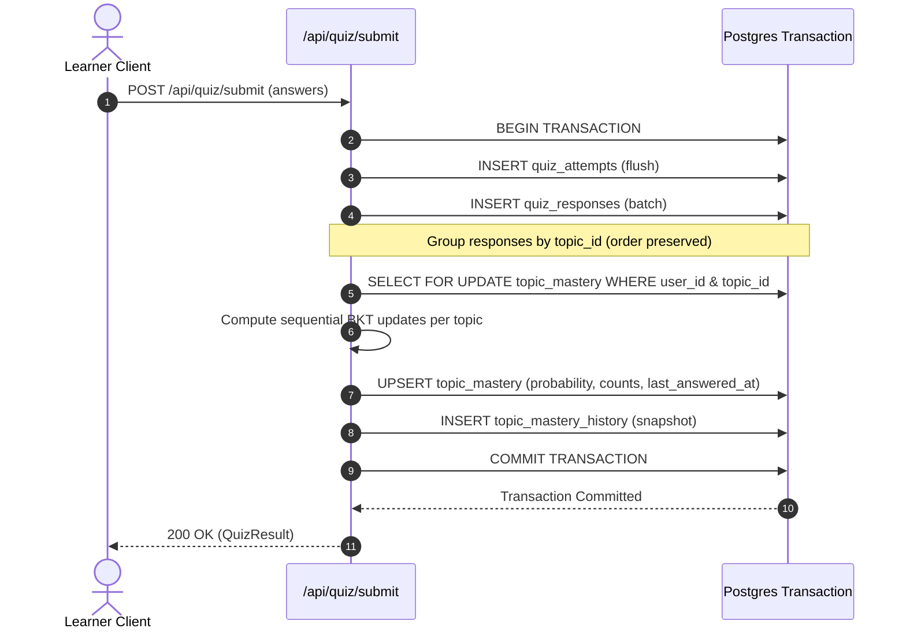

# Bayesian Knowledge Tracing (BKT) Knowledge Model Specification

**Phase:** Phase 5 (Knowledge Tracing Engine)  
**Version:** 1.0.0  
**Status:** Canonical Design Specification (Source of Truth for Chunks 5.1–5.5)  
**Target:** LearnWise Backend (`backend/app/`)

---

## Table of Contents

- [1. Executive Summary & Purpose](#1-executive-summary--purpose)
- [2. Theoretical Foundation](#2-theoretical-foundation)
- [3. Global Configuration & Parameters](#3-global-configuration--parameters)
  - [3.1 Parameter Reference](#31-parameter-reference)
  - [3.2 Difficulty Matrix](#32-difficulty-matrix)
  - [3.3 Heuristic Baseline Notice](#33-heuristic-baseline-notice)
- [4. Mathematical Update Rule & Algorithms](#4-mathematical-update-rule--algorithms)
  - [4.1 Two-Stage Bayesian Formulation](#41-two-stage-bayesian-formulation)
  - [4.2 Probability Clamping & Asymptotic Bounds](#42-probability-clamping--asymptotic-bounds)
  - [4.3 Unit Test Reference Fixtures (Worked Examples)](#43-unit-test-reference-fixtures-worked-examples)
- [5. Competency Classification Engine](#5-competency-classification-engine)
  - [5.1 Classification Rules](#51-classification-rules)
  - [5.2 Read-Time Dynamic Evaluation](#52-read-time-dynamic-evaluation)
  - [5.3 Single-Quiz Competency Dynamics](#53-single-quiz-competency-dynamics)
- [6. Relational Data Architecture](#6-relational-data-architecture)
  - [6.1 Table: `topic_mastery`](#61-table-topic_mastery)
  - [6.2 Table: `topic_mastery_history`](#62-table-topic_mastery_history)
  - [6.3 Row Level Security (RLS)](#63-row-level-security-rls)
  - [6.4 SQLAlchemy Model Schema & Relationships](#64-sqlalchemy-model-schema--relationships)
- [7. Transactional Execution & Concurrency Semantics](#7-transactional-execution--concurrency-semantics)
  - [7.1 Transactional Boundary (`submit_quiz`)](#71-transactional-boundary-submit_quiz)
  - [7.2 In-Attempt Answer Ordering](#72-in-attempt-answer-ordering)
  - [7.3 Pessimistic Row Locking (`FOR UPDATE`)](#73-pessimistic-row-locking-for-update)
- [8. API Specification](#8-api-specification)
  - [8.1 `GET /api/mastery/me`](#81-get-apimasteryme)
  - [8.2 `GET /api/mastery/me/courses/{course_id}`](#82-get-apimasterymecoursescourse_id)
  - [8.3 `GET /api/mastery/me/topics/{topic_id}`](#83-get-apimasterymetopicstopic_id)
  - [8.4 Scope Boundary: Instructor Endpoints](#84-scope-boundary-instructor-endpoints)
- [9. Historical Backfill Pipeline](#9-historical-backfill-pipeline)
  - [9.1 Purpose & Execution Model](#91-purpose--execution-model)
  - [9.2 Deterministic Replay Ordering](#92-deterministic-replay-ordering)
  - [9.3 Idempotency Guarantees](#93-idempotency-guarantees)
  - [9.4 Dry-Run Capability](#94-dry-run-capability)
- [10. Implementation Roadmap (Chunks 5.1–5.5)](#10-implementation-roadmap-chunks-5155)
- [11. Explicit Non-Goals & Out of Scope](#11-explicit-non-goals--out-of-scope)
- [12. Synthetic Learner Population & Simulation Engine](#12-synthetic-learner-population--simulation-engine)
  - [12.1 Purpose & Role in Testing](#121-purpose--role-in-testing)
  - [12.2 Architectural Decoupling: Skill-Based IRT vs. BKT](#122-architectural-decoupling-skill-based-irt-vs-bkt)
  - [12.3 Structured Archetypes](#123-structured-archetypes)
  - [12.4 Valid Inferences & Limitations](#124-valid-inferences--limitations)

---

## 1. Executive Summary & Purpose

The purpose of the LearnWise Knowledge Model is to quantify and track each learner's mastery of individual learning topics in real time. Rather than relying on static quiz percentages, the system maintains a dynamic latent probability $P(L_t) \in (0, 1)$ representing the belief that a learner has mastered a specific topic.

After each question response submitted by a learner, this probability is updated using **Bayesian Knowledge Tracing (BKT)** (Corbett & Anderson, 1994). Based on the resulting posterior probability and the amount of empirical evidence collected, each topic is classified into one of four competency states:
- `not_attempted`
- `weak`
- `developing`
- `strong`

This document serves as the canonical design contract for all implementation chunks in Phase 5.

---

## 2. Theoretical Foundation

Bayesian Knowledge Tracing is a Hidden Markov Model tailored for intelligent tutoring systems. In standard BKT:
- The learner's true knowledge state for a topic is latent (binary: mastered vs. unmastered).
- The system observes discrete performance evidence (binary: correct vs. incorrect).
- Observations are imperfect due to:
  - **Slip ($P(S)$)**: The probability that a learner who knows the skill makes an accidental mistake.
  - **Guess ($P(G)$)**: The probability that an unmastered learner guesses the answer correctly.
- Between learning interactions, knowledge state transitions forward with:
  - **Transit ($P(T)$)**: The probability that an unmastered learner acquires the skill as a result of the practice opportunity.
- The system does not model forgetting (transitions from mastered to unmastered are assumed to have probability 0).

---

## 3. Global Configuration & Parameters

All BKT parameters are declared as global constants in a single configuration module (`backend/app/config/bkt.py` or `backend/app/core/bkt.py`) so they can be tuned without altering update logic.

### 3.1 Parameter Reference

| Constant | Type | Value | Semantic Definition |
| :--- | :--- | :--- | :--- |
| `P_INIT` | `float` | `0.30` | Prior probability of mastery before any topic evidence is recorded. |
| `P_TRANSIT` | `float` | `0.10` | Probability that an unmastered learner transitions to mastered after answering a question. |
| `MIN_P` | `float` | `0.01` | Lower safety bound applied to clamp probability and prevent zero-collapse. |
| `MAX_P` | `float` | `0.99` | Upper safety bound applied to clamp probability and prevent ceiling-lock. |
| `DIFFICULTY_AWARE` | `bool` | `True` | Flag controlling whether question difficulty adjusts slip and guess rates. |

When `DIFFICULTY_AWARE` is set to `False`, the engine strictly defaults to the `medium` difficulty slip and guess parameters for all evaluations regardless of question metadata.

### 3.2 Difficulty Matrix

Slip and guess rates are stratified across lowercase difficulty keys (`easy`, `medium`, `hard`):

```python
DIFFICULTY_PARAMS = {
    "easy": {
        "slip": 0.05,
        "guess": 0.30,
    },
    "medium": {
        "slip": 0.10,
        "guess": 0.25,
    },
    "hard": {
        "slip": 0.15,
        "guess": 0.20,
    },
}
```

*Note on question difficulty normalization:* While the question table stores capitalized strings (e.g., `"Medium"`, `"Easy"`, `"Hard"`), difficulty lookups MUST normalize input keys using `.lower()` before referencing `DIFFICULTY_PARAMS`. Unrecognized difficulty levels fallback to `"medium"`.

### 3.3 Heuristic Baseline Notice

> [!NOTE]
> The parameter values listed above (`P_INIT = 0.30`, `P_TRANSIT = 0.10`, slip $\in [0.05, 0.15]$, guess $\in [0.20, 0.30]$) represent commonly accepted heuristic baselines from educational data mining literature. They are **not fitted from student interaction logs**. As the platform gathers interaction telemetry, these parameters may be calibrated using expectation-maximization (EM) or grid-search optimization.

---

## 4. Mathematical Update Rule & Algorithms

### 4.1 Two-Stage Bayesian Formulation

Let $p$ denote the current probability of mastery prior to the observation ($p = P(L)$).  
Let $s$ denote the slip probability ($s = P(S)$).  
Let $g$ denote the guess probability ($g = P(G)$).

#### Step 1: Posterior Update (Conditioned on Evidence)

- **If the learner answered correctly ($\text{obs} = 1$):**
  $$\text{posterior} = P(L \mid \text{correct}) = \frac{p \cdot (1 - s)}{p \cdot (1 - s) + (1 - p) \cdot g}$$

- **If the learner answered incorrectly ($\text{obs} = 0$):**
  $$\text{posterior} = P(L \mid \text{wrong}) = \frac{p \cdot s}{p \cdot s + (1 - p) \cdot (1 - g)}$$

#### Step 2: Learning Transition

Accounting for the probability of skill acquisition through the practice opportunity itself:
$$p_{\text{new}} = \text{posterior} + (1 - \text{posterior}) \cdot P_{\text{TRANSIT}}$$

### 4.2 Probability Clamping & Asymptotic Bounds

To prevent mathematical saturation (where a probability of $0.0$ or $1.0$ permanently ignores future contradictory evidence due to Bayesian degeneration), the updated probability is strictly clamped to $[\text{MIN\_P}, \text{MAX\_P}]$:

$$p_{\text{final}} = \min(\max(p_{\text{new}}, \text{MIN\_P}), \text{MAX\_P})$$

> [!NOTE]
> **Asymptotic Lower Bound & Clamping Safeguards:**  
> Because of the learning transition step ($p_{\text{new}} = \text{posterior} + (1 - \text{posterior}) \cdot P_{\text{TRANSIT}}$), even if an incorrect response drives the Bayesian posterior close to $0.0$, the transition adds $(1 - 0) \cdot P_{\text{TRANSIT}} = 0.10$. As a result, mastery probability after an extended run of wrong answers asymptotically converges to roughly **$0.11$** (approximately $P_{\text{TRANSIT}}$) rather than `MIN_P = 0.01`. Therefore, `MIN_P` serves primarily as a theoretical numerical safeguard against zero-collapse, while `MAX_P = 0.99` is the bound that actively binds during runs of correct answers.

### 4.3 Unit Test Reference Fixtures (Worked Examples)

The following reference calculations assume a baseline prior $p = 0.30$ and `P_TRANSIT = 0.10`. These exact numerical outcomes serve as deterministic assertions for unit test fixtures:

1. **Medium Question — Correct Answer:**
   - Parameters: $s = 0.10$, $g = 0.25$
   - $\text{posterior} = \frac{0.30 \cdot 0.90}{(0.30 \cdot 0.90) + (0.70 \cdot 0.25)} = \frac{0.27}{0.27 + 0.175} = \frac{0.27}{0.445} \approx 0.60674157$
   - $p_{\text{new}} = 0.60674157 + (1 - 0.60674157) \cdot 0.10 \approx \mathbf{0.6460}$

2. **Medium Question — Incorrect Answer:**
   - Parameters: $s = 0.10$, $g = 0.25$
   - $\text{posterior} = \frac{0.30 \cdot 0.10}{(0.30 \cdot 0.10) + (0.70 \cdot 0.75)} = \frac{0.03}{0.03 + 0.525} = \frac{0.03}{0.555} \approx 0.05405405$
   - $p_{\text{new}} = 0.05405405 + (1 - 0.05405405) \cdot 0.10 \approx \mathbf{0.1486}$

3. **Easy Question — Correct Answer:**
   - Parameters: $s = 0.05$, $g = 0.30$
   - $\text{posterior} = \frac{0.30 \cdot 0.95}{(0.30 \cdot 0.95) + (0.70 \cdot 0.30)} = \frac{0.285}{0.285 + 0.210} = \frac{0.285}{0.495} \approx 0.57575758$
   - $p_{\text{new}} = 0.57575758 + (1 - 0.57575758) \cdot 0.10 \approx \mathbf{0.6182}$

4. **Hard Question — Correct Answer:**
   - Parameters: $s = 0.15$, $g = 0.20$
   - $\text{posterior} = \frac{0.30 \cdot 0.85}{(0.30 \cdot 0.85) + (0.70 \cdot 0.20)} = \frac{0.255}{0.255 + 0.140} = \frac{0.255}{0.395} \approx 0.64556962$
   - $p_{\text{new}} = 0.64556962 + (1 - 0.64556962) \cdot 0.10 \approx \mathbf{0.6810}$

---

## 5. Competency Classification Engine

### 5.1 Classification Rules

Each topic is classified into one of four mutually exclusive competency categories based on empirical answers recorded and current mastery probability $p$:

| Status | Total Answers Requirement | Probability Condition | Semantic Meaning |
| :--- | :--- | :--- | :--- |
| `not_attempted` | `total_answers == 0` | Any (or no `topic_mastery` row) | The learner has never answered any question under this topic. |
| `weak` | `total_answers > 0` | $p < 0.40$ | The learner exhibits frequent misconceptions or low accuracy. |
| `developing` | `total_answers > 0` | $0.40 \le p < 0.80$ OR ($p \ge 0.80$ with $\text{total\_answers} < 3$) | The learner is making progress, or high score has insufficient sample size. |
| `strong` | $\text{total\_answers} \ge 3$ | $p \ge 0.80$ | High mastery supported by a minimum evidentiary threshold of 3 answers. |

### 5.2 Read-Time Dynamic Evaluation

> [!IMPORTANT]
> **Competency status is NEVER stored in database tables.**  
> Status is derived on-the-fly during read requests (or serializer serialization). This architectural decision avoids data synchronization anomalies if classification thresholds or parameters are reconfigured in the future.

### 5.3 Single-Quiz Competency Dynamics

> [!NOTE]
> **Reaching Strong Status Within One Quiz:**  
> With typical quiz configurations distributing 3 to 4 questions per topic across a 20-question course quiz, a topic can only reach `"strong"` ($p \ge 0.80$ and $\text{total\_answers} \ge 3$) within a single quiz if **all** answers for that topic are correct (e.g., starting from $P_{\text{INIT}} = 0.30$, three consecutive correct medium answers progress: $0.30 \rightarrow 0.6461 \rightarrow 0.8811 \rightarrow 0.9675$). If a learner answers even one question incorrectly under that topic, the mastery drop prevents it from reaching the $0.80$ threshold within the same attempt, requiring further quiz attempts to achieve `"strong"` status.

---

## 6. Relational Data Architecture

Two new tables track state and historical progression.

### 6.1 Table: `topic_mastery`

Maintains the current point-in-time mastery probability for a specific `(user_id, topic_id)` pair.

```sql
CREATE TABLE topic_mastery (
    id SERIAL PRIMARY KEY,
    user_id INTEGER NOT NULL REFERENCES users(id) ON DELETE CASCADE,
    topic_id INTEGER NOT NULL REFERENCES topics(id) ON DELETE CASCADE,
    mastery_probability DOUBLE PRECISION NOT NULL DEFAULT 0.30,
    total_answers INTEGER NOT NULL DEFAULT 0,
    correct_answers INTEGER NOT NULL DEFAULT 0,
    last_answered_at TIMESTAMPTZ NULL,
    created_at TIMESTAMPTZ NOT NULL DEFAULT NOW(),
    updated_at TIMESTAMPTZ NOT NULL DEFAULT NOW(),
    CONSTRAINT uq_topic_mastery_user_topic UNIQUE (user_id, topic_id),
    CONSTRAINT chk_topic_mastery_probability CHECK (mastery_probability >= 0.0 AND mastery_probability <= 1.0)
);

CREATE INDEX ix_topic_mastery_user_id ON topic_mastery (user_id);
```

### 6.2 Table: `topic_mastery_history`

Maintains an immutable audit ledger recording the state change of a topic's mastery produced by each quiz attempt.

```sql
CREATE TABLE topic_mastery_history (
    id SERIAL PRIMARY KEY,
    user_id INTEGER NOT NULL REFERENCES users(id) ON DELETE CASCADE,
    topic_id INTEGER NOT NULL REFERENCES topics(id) ON DELETE CASCADE,
    attempt_id INTEGER NOT NULL REFERENCES quiz_attempts(id) ON DELETE CASCADE,
    mastery_before DOUBLE PRECISION NOT NULL,
    mastery_after DOUBLE PRECISION NOT NULL,
    answers_in_attempt INTEGER NOT NULL,
    correct_in_attempt INTEGER NOT NULL,
    created_at TIMESTAMPTZ NOT NULL DEFAULT NOW(),
    CONSTRAINT uq_topic_mastery_history_attempt_topic UNIQUE (attempt_id, topic_id)
);

CREATE INDEX ix_topic_mastery_history_user_topic_created 
ON topic_mastery_history (user_id, topic_id, created_at);
```

### 6.3 Row Level Security (RLS)

In compliance with Phase 3B security policy, both tables have Row Level Security enabled with no policies defined:

```sql
ALTER TABLE topic_mastery ENABLE ROW LEVEL SECURITY;
ALTER TABLE topic_mastery_history ENABLE ROW LEVEL SECURITY;
```

This prevents accidental exposure via PostgREST/Supabase client libraries while allowing the backend owner role full operational access.

### 6.4 SQLAlchemy Model Schema & Relationships

- `TopicMastery`:
  - `user`: `relationship("User", back_populates="topic_masteries")`
  - `topic`: `relationship("Topic", back_populates="masteries")`
- `TopicMasteryHistory`:
  - `user`: `relationship("User")`
  - `topic`: `relationship("Topic")`
  - `quiz_attempt`: `relationship("QuizAttempt", back_populates="mastery_histories")`

---

## 7. Transactional Execution & Concurrency Semantics

### 7.1 Transactional Boundary (`submit_quiz`)

Mastery updates MUST NOT run asynchronously or outside the quiz submission transaction. The entire update lifecycle runs inside the single database transaction that persists `quiz_attempts` and `quiz_responses`:



If any failure occurs during mastery update or history recording, the transaction rolls back completely. There can never be an orphan quiz attempt missing its corresponding mastery update.

### 7.2 In-Attempt Answer Ordering

When a quiz attempt contains multiple questions mapped to the same topic:
1. Answers are evaluated strictly in the sequential order they appear in the submitted answers list (`submission.answers`).
2. Each answer updates the running posterior probability.
3. The next answer for that same topic takes the output of the prior update as its starting prior $p$.
4. At the end of the attempt:
   - `topic_mastery` receives the final accumulated probability, increments `total_answers` and `correct_answers` by the attempt counts, and updates `last_answered_at`.
   - `topic_mastery_history` records one single aggregated row per `(attempt_id, topic_id)` containing `mastery_before`, `mastery_after`, `answers_in_attempt`, and `correct_in_attempt`.

### 7.3 Pessimistic Row Locking (`FOR UPDATE`)

To prevent lost updates caused by concurrent quiz submissions from the same user across multiple client sessions or fast-paced submissions:
1. When acquiring existing `topic_mastery` rows for the user, the query uses:
   ```python
   db.query(TopicMastery).filter(
       TopicMastery.user_id == current_user.id,
       TopicMastery.topic_id.in_(attempt_topic_ids)
   ).with_for_update().all()
   ```
2. If no `topic_mastery` row exists yet for a topic, an empty row initialized to `P_INIT = 0.30` is inserted or handled through an upsert.

---

## 8. API Specification

All mastery endpoints require authentication via `current_user: User = Depends(get_current_user)`. Learners can only inspect their own mastery data.

### 8.1 `GET /api/mastery/me`

Returns the mastery status of every topic across all courses in the platform, including unattempted topics. Uses a single joined query to eliminate N+1 latency.

**Query Parameters:**
- `course_id` (optional, integer): Filter results to a specific course.

**Response Structure (200 OK):**
```json
[
  {
    "course_id": 1,
    "course_title": "Computer Networks",
    "topic_id": 1,
    "topic_title": "TCP/IP Protocol Suite",
    "order": 1,
    "mastery_probability": 0.646,
    "status": "developing",
    "total_answers": 1,
    "correct_answers": 1,
    "last_answered_at": "2026-10-17T12:00:00Z"
  },
  {
    "course_id": 1,
    "course_title": "Computer Networks",
    "topic_id": 2,
    "topic_title": "Routing Algorithms",
    "order": 2,
    "mastery_probability": null,
    "status": "not_attempted",
    "total_answers": 0,
    "correct_answers": 0,
    "last_answered_at": null
  }
]
```

### 8.2 `GET /api/mastery/me/courses/{course_id}`

Returns a high-level mastery summary for a specific course, including aggregated status counts, average mastery across attempted topics, and topic breakdown. Returns 404 if the course does not exist. Uses a single joined query.

**Response Structure (200 OK):**
```json
{
  "course_id": 1,
  "course_title": "Computer Networks",
  "summary": {
    "total_topics": 6,
    "not_attempted": 2,
    "weak": 1,
    "developing": 2,
    "strong": 1,
    "average_mastery_attempted": 0.725
  },
  "topics": [
    {
      "course_id": 1,
      "course_title": "Computer Networks",
      "topic_id": 1,
      "topic_title": "TCP/IP Protocol Suite",
      "order": 1,
      "mastery_probability": 0.85,
      "status": "strong",
      "total_answers": 4,
      "correct_answers": 4,
      "last_answered_at": "2026-10-17T12:00:00Z"
    }
  ]
}
```

*Note on `average_mastery_attempted`:* Calculated strictly over topics where `total_answers > 0`. If no topics in the course have been attempted, returns `null`.

### 8.3 `GET /api/mastery/me/topics/{topic_id}`

Returns the detailed mastery state and chronological progression history for a single topic. Returns 404 if the topic does not exist.

**Response Structure (200 OK):**
```json
{
  "course_id": 1,
  "course_title": "Computer Networks",
  "topic_id": 1,
  "topic_title": "TCP/IP Protocol Suite",
  "order": 1,
  "mastery_probability": 0.85,
  "status": "strong",
  "total_answers": 4,
  "correct_answers": 4,
  "last_answered_at": "2026-10-17T12:00:00Z",
  "history": [
    {
      "attempt_id": 101,
      "mastery_before": 0.30,
      "mastery_after": 0.646,
      "answers_in_attempt": 1,
      "correct_in_attempt": 1,
      "created_at": "2026-10-17T10:00:00Z"
    },
    {
      "attempt_id": 105,
      "mastery_before": 0.646,
      "mastery_after": 0.85,
      "answers_in_attempt": 3,
      "correct_in_attempt": 3,
      "created_at": "2026-10-17T12:00:00Z"
    }
  ]
}
```
*Note:* The `history` list is ordered strictly chronologically (`created_at ASC, id ASC`, oldest first). Topics with no recorded attempts return the unattempted shape with `mastery_probability: null`, `status: "not_attempted"`, `total_answers: 0`, and `history: []`.

### 8.4 Scope Boundary: Instructor Endpoints

Instructor-facing analytics (e.g., class distribution per topic, student heatmaps) are deferred to the Dashboards phase and are excluded from Phase 5.

---

## 9. Historical Backfill Pipeline

### 9.1 Purpose & Execution Model

A standalone administrative script (`backend/app/seeds/backfill_mastery.py`) replays historical quiz attempts executed prior to the activation of the BKT engine into `topic_mastery` and `topic_mastery_history`.

### 9.2 Deterministic Replay Ordering

Because BKT probability updates are strictly order-dependent, replaying attempts out of order would corrupt mastery states. The replay processes:
1. `QuizAttempt` records ordered by `QuizAttempt.id ASC` (chronological submission order).
2. Associated `QuizResponse` records for each attempt ordered by `QuizResponse.id ASC`.
3. Calls the canonical `apply_attempt(db, user_id, attempt, responses)` function used by live submissions to ensure zero mathematical drift.

### 9.3 Per-User Idempotency Rules

To prevent historical attempts from being interleaved after newer live attempts:
1. **Unrecorded Users (Clean Backfill):** For users with quiz attempts and NO existing `topic_mastery` or `topic_mastery_history` rows, all attempts are replayed chronologically.
2. **Existing Mastery Guard (Skipping):** If a user already possesses any `topic_mastery` or `topic_mastery_history` rows, the script skips that user entirely, printing a warning with the user ID and unprocessed attempt count. No partial writes are executed.
3. **Explicit User Rebuild (`--rebuild-user <user_id>`):** To fix a user with mixed historical/live attempts, an explicit user ID must be provided. Inside a single database transaction, the script removes that user's existing `topic_mastery` and `topic_mastery_history` rows and replays all attempts in original chronological sequence. Global `--rebuild-all` is prohibited to prevent accidental bulk loss of learner states.

### 9.4 Dry-Run Capability

The script supports a `--dry-run` flag:
```zsh
python -m app.seeds.backfill_mastery --dry-run
python -m app.seeds.backfill_mastery --rebuild-user <user_id> --dry-run
```
When invoked with `--dry-run`, all computations and candidate deletions/replays are executed inside an active database transaction that triggers `db.rollback()` at completion, guaranteeing zero database mutations.

---

## 10. Implementation Roadmap (Chunks 5.1–5.5)

To ensure high reliability and zero regressions, Phase 5 is partitioned into modular chunks:

- **Chunk 5.0 (Completed):** System Design Specification (`docs/KNOWLEDGE_MODEL.md`).
- **Chunk 5.1 (Completed):** Database Models (`TopicMastery`, `TopicMasteryHistory`), Alembic Migration `a7a34be56dbb`, and RLS enablement.
- **Chunk 5.2 (Completed):** BKT Configuration & Core Algorithm Module (`backend/app/services/bkt.py`) with unit test suite verifying worked examples and clamping behavior.
- **Chunk 5.3 & 5.3b (Completed):** Transactional Integration into `submit_quiz` (`apply_attempt`) with row locking (`SELECT FOR UPDATE`), savepoint race handling, and atomicity verification.
- **Chunk 5.4 (Completed):** Learner-facing Mastery API Endpoints (`/api/mastery/...`) and Pydantic response schemas with single-query N+1 avoidance.
- **Chunk 5.5 (Completed):** Per-User Historical Replay/Backfill Script with `--dry-run`, `--rebuild-user`, and test suite.
- **Chunk 5.6 (Completed):** Synthetic Learner Population Seeding (`backend/app/seeds/seed_synthetic_learners.py`) with 5 archetype profiles, IRT response modeling, and validation suite.

---

## 11. Explicit Non-Goals & Out of Scope

The following capabilities are deliberately excluded from Phase 5:

1. **Mastery Decay / Forgetting Curves:** Standard BKT assumes $P(\text{unlearn}) = 0$. Time-decay functions (e.g., Ebbinghaus exponential forgetting) are deferred.
2. **Empirical Parameter Estimation:** Per-topic parameter optimization via Expectation-Maximization (EM) or Baum-Welch training is out of scope.
3. **Adaptive Recommendations:** The recommender logic that consumes topic mastery to suggest personalized resources or diagnostic quizzes will be implemented in a subsequent phase.
4. **Frontend UI Components:** No React or Vite changes are included in Phase 5 backend chunks.

---

## 12. Synthetic Learner Population & Simulation Engine

### 12.1 Purpose & Role in Testing
To support platform demonstration, collaborative filtering development, and A/B evaluation before live learners populate the platform, a deterministic synthetic population generator is provided in `backend/app/seeds/seed_synthetic_learners.py`.

### 12.2 Architectural Decoupling: Skill-Based IRT vs. BKT
Synthetic learner responses are generated using a 3-parameter-style Item Response Theory (IRT) logistic model, deliberately **decoupled** from BKT's inner parameters:

$$P(\text{correct}) = 0.25 + 0.75 \cdot \sigma\left(4 \cdot (\theta_{\text{topic}} - b_{\text{difficulty}})\right)$$

where:
- $0.25$ represents the baseline guess rate on 4-option multiple-choice questions.
- $\sigma(z) = \frac{1}{1 + e^{-z}}$ is the standard sigmoid logistic function.
- $\theta_{\text{topic}} \in [0.05, 0.95]$ represents the learner's continuous latent skill on that topic.
- $b_{\text{difficulty}}$ represents item difficulty: $-0.25$ for easy, $0.0$ for medium, and $+0.25$ for hard.
- Between consecutive quiz attempts, a learner's topic skill experiences a small deterministic gain ($+0.03$, clamped at $0.95$) to simulate learning.

**Why Decouple from BKT?**
If synthetic answers were generated using BKT parameters ($p, P_T, s, g$), the evaluation would suffer from circular validation (the model evaluating its own generative distribution). Simulating answers via an independent continuous skill model provides an objective stress-test of BKT's Bayesian estimation under realistic, non-idealized response conditions.

### 12.3 Structured Archetypes
The synthetic population is structured deterministically into 5 archetypes:
1. **Group A (01–10):** High mastery across all domains ($\mu \approx 0.80$).
2. **Group B (11–20):** Low mastery across all domains ($\mu \approx 0.30$).
3. **Group C (21–30):** Domain specialization in Systems ("Computer Networks" and "Operating Systems" $\mu \approx 0.80$; "OOPS" and "SQL/DBMS" $\mu \approx 0.35$).
4. **Group D (31–40):** Domain specialization in Software/Data ("OOPS" and "SQL/DBMS" $\mu \approx 0.80$; "Computer Networks" and "Operating Systems" $\mu \approx 0.35$).
5. **Group E (41–50):** Average overall ability ($\mu \approx 0.55$) with high topic variance ($\sigma \approx 0.18$).

### 12.4 Valid Inferences & Limitations
- **What it supports:**
  - Proves the end-to-end ingestion, attempt storage, transaction integrity, and BKT update pipeline work reliably at scale.
  - Generates clear clustering and latent correlation structure for collaborative filtering and recommender system evaluation.
  - Enables performance benchmarks and UI smoke-testing on populated dashboards.
- **What it does NOT support:**
  - **Does NOT demonstrate real empirical learning gains:** Simulated skill progression is synthetic and does not represent verified pedagogical efficacy.
  - **Does NOT calibrate BKT parameters:** Synthetic accuracy rates reflect the logistic response curve rather than empirical student answer distributions.
